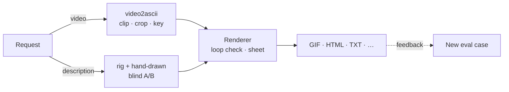

# ascii-animation

A Claude Code skill that turns a video, or a description of a motion, into a looping ASCII animation using a dense colour-inked style. Examples in `examples/` are that banner's animations.

Ask Claude for "the first 6 seconds of this clip as an ASCII GIF for my README" or "a looping ASCII cat stretching then curling up". The skill picks the right pipeline, makes the loop seamless, checks a contact sheet, and exports in the format your target needs.

## How it works



Every path ends in the same renderer, so converted footage and invented motion share one look:

1. Each frame is box-averaged into square character cells.
2. Brightness, contrast, saturation and gamma are adjusted.
3. Each cell gets a glyph from a light-to-dense ramp.
4. Each glyph is inked in the cell's own colour.

## Install

Requirements: [Claude Code](https://code.claude.com) and [`uv`](https://docs.astral.sh/uv/). Each script declares its own Python dependencies (numpy, pillow, imageio-ffmpeg, scipy), so you don't need system ffmpeg or a global Python setup. For URLs, the skill runs yt-dlp through `uv tool run`.

```bash
git clone git@github.com:amrevr/asciify.git ~/.claude/skills/ascii-animation
# or over HTTPS:
git clone https://github.com/amrevr/asciify.git ~/.claude/skills/ascii-animation
```

Check the toolchain (about a minute, no network):

```bash
cd ~/.claude/skills/ascii-animation && uv run scripts/selftest.py
```

## Using it

Ask in plain words; Claude loads the skill when the request fits. Some requests it handles:

- "Turn the first 9 seconds of <YouTube link> into a monochrome ASCII animation for my site's about page"
- "Make a looping ASCII GIF of `dance.mp4` for the top of my GitHub profile"
- "Convert `skater.mp4`, but only the skater should show; the background is too busy"
- "An ASCII animation of someone doing jumping jacks, for my terminal app's splash screen"
- "A little ASCII frog that blinks and ribbits, looping, for my Discord bot"

### From a video

The skill downloads only the section you name; with no range, it picks 2–6 s around the main action and tells you which. It converts that section, checks the contact sheet, and fixes what it sees:

| Problem | Fix, cheapest first |
|---|---|
| Subject lost in a busy background | `--crop`, then `--key auto`: a median background of the clip, aligned for panning, minus the subject, keeping the largest blob. If that isn't enough, `--segment` (rembg). It downloads a ~170 MB model, so the skill asks you first, every time. |
| Visible jump when the loop restarts | Cut where the poses match, or `--pingpong`: forward then backward, with no repeated frame at the turns. |
| File too big | `--max-mb 10` raises `--step` until the GIF fits. `--mono` and fewer `--cols` shrink it further. |
| Wrong facing direction | `--mirror` |

Some sites (Douyin, TikTok, Instagram) usually need your logged-in cookies. When a download fails, the skill tells you the real cause (the site, or a network block) and asks for the file. It never makes an animation from footage it couldn't fetch.

### From a description

There are two generators that fail in different ways, so the skill builds both and lets you choose blind:

- **A, the pose rig** (`scripts/rig.py`): a procedural, faceless figure driven by keyed channels:
  - yaw;
  - squat;
  - arm swing and arms overhead;
  - stance width;
  - hops;
  - a jig;
  - a walk gait;
  - springs that make the hair and hem follow through.

  It gives smooth in-betweens and real shading, but it is one character, not a general skeleton.
- **B, hand-drawn keyframes** (`scripts/frames2ascii.py`): frames written as text. It works for any subject (animals, objects, logos) and is more stylised.

`ab_compare.py` puts the two side by side as "A" and "B" in random order. When the rig doesn't fit the subject, the skill compares two hand-drawn styles instead, so you always get a choice. Your pick is remembered as a preference for next time.

### Loops

A visible seam is the most common complaint, so every exporter prints a seam score: the fraction of cells that change between the last frame and the first.

- **Rig:** timelines must pass `check_loop`, which requires the pose, turns and walk phase to come back exactly. `pose2ascii.py` refuses to render one that doesn't.
- **Hand-drawn:** the file is checked for equal frame sizes and for a duplicated frame 0 at the end.
- **Joined segments** (`examples/cycle.py`): each join is asserted to be character-identical.

### Choosing an export

| Target | Format | Notes |
|---|---|---|
| GitHub README | `.gif` | Kept under ~10 MB. Embed with ``. |
| Website | `.html` | A marked paste block: a `<pre>` plus a scoped script. It follows `prefers-reduced-motion` live and pauses offscreen. |
| Your own component | `.json` | Frames as strings, plus per-cell colours unless the export is monochrome. |
| Terminal | `.txt` | Frames separated by form-feed lines. |
| Chat / social | `.webp`, `.mp4` | Smaller than GIF at the same quality. |

## Running the scripts directly

Claude runs these for you, but each is a normal CLI (`--help` lists every option):

```bash
uv run scripts/video2ascii.py clip.mp4 -o banner.gif --start 0 --dur 6 --cols 120 --max-mb 10 --sheet sheet.png
uv run scripts/video2ascii.py https://… -o about.html --dur 9 --mono '#e8e0d0' --pingpong
uv run scripts/pose2ascii.py examples/twirl.py -o twirl.gif --no-scene --step 2
uv run scripts/frames2ascii.py cat.txt -o cat.gif --sheet cat.png
uv run scripts/ab_compare.py a.gif b.gif -o ab.html --labels rig,hand
```

| Script | Role |
|---|---|
| `ascii_render.py` | Shared core: cell averaging, colour pass, glyph ramps, drawing, every exporter, seam score, contact sheets |
| `video2ascii.py` | Video file or URL → animation (download, trim, crop, key, pingpong, size cap) |
| `rig.py`, `pose2ascii.py` | The procedural figure, and the CLI that loop-checks and renders a timeline module |
| `frames2ascii.py` | Hand-drawn keyframe file (`--- frame`, `--- frame x3` to hold) → animation |
| `ab_compare.py` | Blind side-by-side page; prints which side is which to stdout only |
| `check_output.py` | Code checks on any output: size, frames, seam, equal rows, single colour, coverage, reduced motion |
| `record_eval.py` | Turns a moment of real use into an eval case |
| `selftest.py` | Assert-based checks of all of the above |

`references/` holds the detail Claude reads on demand:

- `sources.md`: getting footage;
- `rendering.md`: the renderer and its knobs;
- `pose-rig.md`: the rig API, its channels and the loop rules;
- `hand-drawn.md`: the keyframe format and drawing advice.

## Evals: how this skill is tested

The skill's tests grow out of real use rather than guesses about what users want. They come in two layers.

### 1. A baseline that ships with the skill

`evals/` holds six cases, each checking a rule that holds for anyone using the skill:

| Case | Rule |
|---|---|
| `video-clip-to-readme-gif` | The export meets its target's limits, the subject reads clearly, and the seam is fixed or reported |
| `web-player-reduced-motion` | Web output is real text, follows reduced motion and keeps the correct character aspect |
| `douyin-link-needs-file` | Nothing is made from footage that couldn't be fetched, and the stated cause matches what actually happened |
| `busy-background-asks-first` | Cheap isolation runs before the large model download, and that download needs a yes |
| `description-human-action` | A described motion produces two blind A/B candidates, both looping |
| `description-nonhuman` | When the rig doesn't fit, there are still two candidates, in two hand-drawn styles |

The input clips are synthetic (`uv run evals/make_fixtures.py`), so the repo carries no third-party footage, and no case needs the network. `evals/trigger-queries.json` is a separate set of 20 prompts that should or shouldn't load the skill, for tuning its description.

### 2. Cases recorded from your own use

Everything specific to how you use the skill is recorded as you use it. When one of these moments happens, Claude runs `record_eval.py`:

| Moment | Example | What becomes the test |
|---|---|---|
| Critique | "her arms flail too much" | The request, its inputs, the rejected output, and the critique made general: "during a walk the arms swing close to the body" |
| Approval | "perfect" | The approved output, kept as a reference for blind comparison |
| A/B pick | you chose B | The choice and your reason, so the preference is tested, not just remembered |
| Failure | a download failed | The correct behaviour, e.g. "reports the network block and asks for approval" |

Cases go to `~/.claude/skill-evals/ascii-animation/` (or `$ASCII_ANIMATION_EVALS`), outside the skill folder, so updating the skill never wipes them. Claude tells you in one line when it records one; say "don't record" to turn that off. `record_eval.py --list` shows what has been collected. Over time, that folder holds your actual standards, and every new version of the skill has to keep meeting them.

### How cases are graded

- **Measurable claims are graded by code.** `check_output.py` checks:
  - file size;
  - frame count;
  - loop seam;
  - equal rows;
  - single colour;
  - blank output;
  - the reduced-motion handler.

  It judges behaviour, not markup, so any player that honours reduced motion passes, not just this skill's.
- **Everything else is a yes/no question** that a judge model answers from the transcript, the files and the contact sheet. There are no 1–10 scores: a pass or fail per criterion is easier to check against your own judgement and easier to act on.
- **Every check must be able to fail.** When a case has both an approved and a rejected output, `record_eval.py` runs each code check against both. It warns if a check passes the rejected one or fails the approved one, because such a check doesn't measure the complaint, and the critique belongs with the judge instead. New graders should also fail on an empty output folder.

### Running them

- **With skill-creator** ("run the ascii-animation evals"): each case runs with and without the skill, the runs are graded and benchmarked, and a review page opens for your feedback. Point it at `evals/`, at your recorded cases, or at both.
- **With the Claude Code CLI**, from the skill folder: `claude plugin eval . --allow-tools Write,Edit,Bash --scaffold`. To include your recorded cases, copy them into `evals/` of a working copy first. These are real, billed model runs.
- Run each case about three times per configuration. With a single run, the spread is too wide to tell a real improvement from noise.

## Limits

- The pose rig is one tuned character, a girl in a skirt and bow on an optional night road. It can't sit, lie down, show two people, or draw facial features (left out on purpose: at this size they read as uncanny).
- `--key auto` needs a subject that moves against the background. It assumes the camera only pans, and parts matching the background colour can drop out.
- Logged-in sites need you to supply the file. The skill can't use your browser's cookies.
